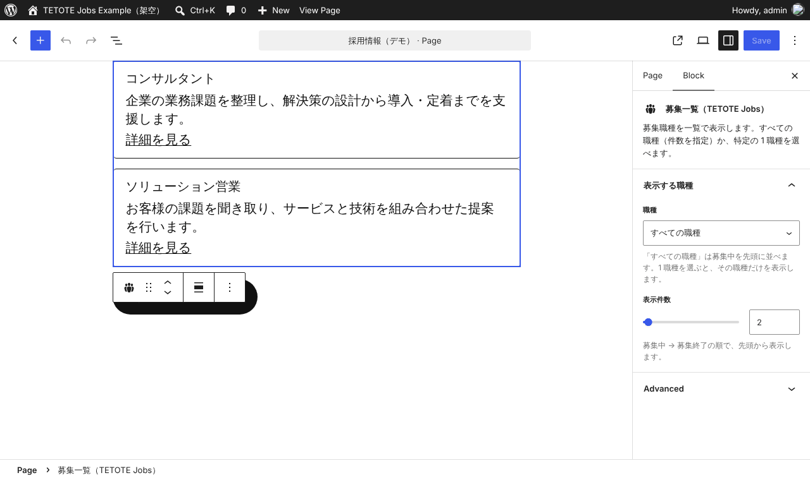
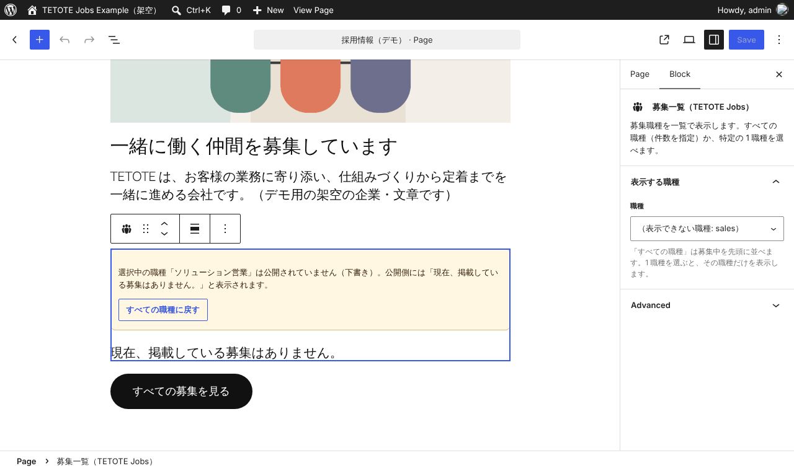
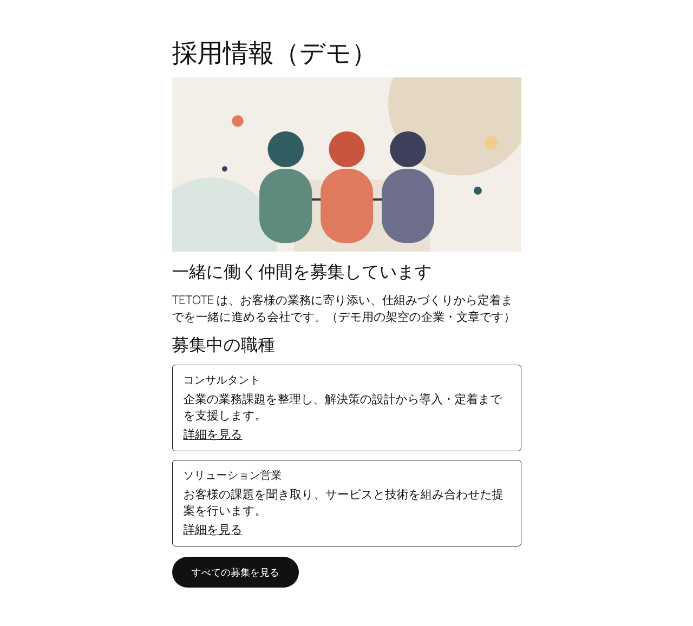
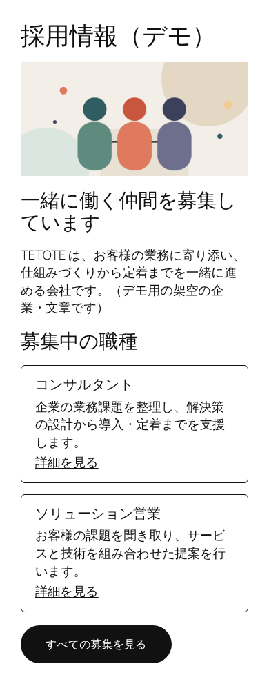

# tetote-wp-jobs-example

[](https://github.com/tzk-s/tetote-wp-jobs-example/actions/workflows/test.yml)

募集職種を WordPress のカスタム投稿で管理し、管理画面で「募集中／募集終了」を切り替えると公開側の一覧・詳細に反映される、プラグインの公開用サンプルです。

> このリポジトリは [tetote-application-example](https://github.com/tzk-s/tetote-application-example) とは連携しません。同じ募集情報を題材に、WordPress 側の登録・保存・表示だけを独立して確認できる公開用サンプルです。

自主制作サイト（架空企業の採用サイト「TETOTE」）では、募集情報を WordPress のテーマで管理しています。このリポジトリは、その考え方（職種 ID・募集終了の扱い）をもとに、**公開用にプラグインとして新しく書いたもの**です。元サイトのテーマのコードは含みません（詳しくは「[元サイトとの関係](#元サイトとの関係)」）。

- 元の公開サイト（架空の企業「TETOTE」の採用サイト）: https://recruit-tetote.preview-dev.website/

> 募集データは架空のものです。実在の求人ではありません。

## ブラウザーで試す（WordPress Playground）

インストール不要で、ブラウザーの中だけで一時的な WordPress が起動します。共有のユーザー名・パスワードはありません。変更はそのブラウザーの中だけで、閉じると消えます。

1. **[管理画面を試す](https://playground.wordpress.net/?blueprint-url=https://raw.githubusercontent.com/tzk-s/tetote-wp-jobs-example/main/playground/blueprint-admin.json)** … 管理者としてログインした状態で「募集職種」の一覧が開きます
2. **[公開側の表示を見る](https://playground.wordpress.net/?blueprint-url=https://raw.githubusercontent.com/tzk-s/tetote-wp-jobs-example/main/playground/blueprint-public.json)** … 募集一覧のページが開きます

2 つのリンクは、それぞれ別の WordPress を起動します。「管理画面を試す」で変えた内容は、「公開側の表示を見る」には反映されません（こちらは毎回初期データで開きます）。変更の反映を確かめるときは、「管理画面を試す」で開いた同じ画面のまま、公開側へ移動してください。

おすすめの確認手順:

1. 管理画面で「ソリューション営業」を開き、右側の「募集状態と職種 ID」で「募集中」のチェックを外して「更新」を押す
2. 画面上部のサイト名から公開側を開き、メニューの「募集一覧」を開く
3. 「ソリューション営業」が一覧の後ろに回り、「募集終了」と表示されていること、詳細ページに終了の案内が出ることを確認する

Playground は起動のたびに GitHub の main ブランチからプラグインを読み込みます（Blueprint は `playground/` にあります）。デモでは、このサンプルで使わない管理メニュー（投稿・メディア・コメント・ツール）と WordPress の初期サンプル記事を隠しています（`tetote-jobs/demo/admin.php`。プラグイン本体には含みません）。社内ネットワークなどで外部サイトが制限されている場合は開けないことがあります。初回の起動には数十秒かかります。

## このサンプルで見てほしいこと

- **カスタム投稿とフィールドを、プラグインに頼らず PHP で定義している。** `register_post_type` と `register_post_meta` で登録し、入力欄はメタボックスで作っています。項目の定義（項目名・入力の種類・更新担当者向けの説明）は `includes/fields.php` の 1 か所だけに置き、入力欄・保存・表示はそこから作ります。
- **保存時の確認。** nonce（この編集画面から送られたか）、自動保存・リビジョンでないか、`current_user_can( 'edit_post' )`（その投稿を編集できるか）を確かめてから保存します。値は項目の種類ごとに `sanitize_text_field` / `sanitize_textarea_field` でそろえ、文字数の上限で切ります。定義にないキーは保存しません。`register_post_meta` にも同じ `sanitize_callback` を付け、この画面以外から保存されても同じ規則になるようにしています。
- **出力時のエスケープ。** 公開側も管理画面も、出力する場所に合わせて `esc_html` / `esc_attr` / `esc_url` / `esc_textarea` を使います。複数行の値はエスケープしてから改行を `<br>` にしています（順番を逆にするとタグが通るため）。
- **募集終了の表示制御。** 募集終了の職種は一覧から消さず、後ろへ回して「募集終了」と文字で示します。詳細ページも 404 にせず、終了したことと一覧への道を示します。外部に残ったリンクから来た人が迷わないようにするためです。
- **職種 ID を変えさせない。** 投稿のスラッグを職種 ID として URL に使うため、正しい形式の ID で初めて公開したときに ID を控え、以後は `wp_insert_post_data` で変更を元に戻します（下書きに戻した場合や、クイック編集などの経路も含む）。日本語のタイトルから自動で作られたスラッグなど、形式の合わない ID は一覧に出さず、管理画面の一覧で警告します。この場合は控えないので、公開したまま正しい ID へ直せます。
- **更新担当者向けの説明。** 各入力欄に説明を付け、「チェックを外すと募集終了になる」「公開後は職種 ID を変えられない」など、操作の結果を画面上で伝えます。
- **募集一覧ブロック（自主制作の技術デモ）。** ブロックエディターで募集一覧を置き、「すべての職種（件数を指定）」か「特定の 1 職種」を選べます。編集画面は React／TypeScript、公開側の表示と入力値の検証は PHP です。詳しくは「[募集一覧ブロックと採用デモページ](#募集一覧ブロックと採用デモページ)」。

## 募集一覧ブロックと採用デモページ

自主制作の技術デモです。採用担当者がブロックエディター（Gutenberg）でページの文言・画像を直し、募集一覧に出す職種や件数を変えられることを示します。採用デモページ（`/recruit-demo/`）は、標準ブロック（画像・見出し・段落・ボタン）と、このプラグインの募集一覧ブロック 1 個でできた簡素なページです。画像は図形だけで描いた自作のものです。



### 最短の操作手順（Docker）

1. 下の「[Docker で動かす](#docker-で動かす)」の 3 行で起動する（初期設定で採用デモページも作られます）
2. http://127.0.0.1:8088/wp-admin/ にログインし、「固定ページ」（Pages）から「採用情報（デモ）」を開く
3. 「募集中の職種」の下の一覧をクリックし、右側の「表示する職種」で職種や「表示件数」を変える。見出しや段落、画像も、その場で直せます
4. 右上の「保存」（Save）を押し、「固定ページを表示」（View Page）で公開側に反映されたことを確かめる

ブロックの設定:

- **職種**: 「すべての職種」か、公開中の 1 職種を選びます。すべての職種は、公開側と同じく募集中を先頭に並べます
- **表示件数**: 「すべての職種」のときだけ表示され、使われます（1〜20）。1 職種を選んでいる間は隠れますが、値は残るので、すべての職種に戻すと元の件数になります
- **選んだ職種が削除・非公開になったとき**: 編集画面に理由（下書き・非公開など、または見つからない）と「すべての職種に戻す」ボタンを出します。公開側には、ショートコードの一覧と同じ「現在、掲載している募集はありません。」を表示します



| PC | スマートフォン |
| --- | --- |
|  |  |

### React／TypeScript と PHP の受け持ち

| 受け持つもの | 場所 | 内容 |
| --- | --- | --- |
| React／TypeScript（TSX） | `src/jobs-list/edit.tsx` | 右側の設定欄（職種・表示件数）、件数欄の出し分け、削除・非公開の職種の案内と「すべての職種に戻す」。中央のプレビューは PHP の表示をそのまま見せる（`ServerSideRender`） |
| | `src/jobs-list/index.tsx`・`block.json` | ブロックの登録。設定値（`jobId`・`count`）の定義。`save` は `null` で、HTML は保存しない |
| PHP | `tetote-jobs/includes/block.php` | 公開側の表示（ショートコードと同じ HTML）、設定値の検証（件数を 1〜20 に収める・形式外の職種 ID は該当なし）、編集画面が使う職種一覧の REST API（投稿を編集できるユーザーだけ） |
| | `tetote-jobs/demo/seed.php` | 採用デモページと画像の作成。同じスラッグのページがあれば何もしない（増やさない・上書きしない） |

保存するのは職種 ID（投稿のスラッグ）で、投稿 ID ではありません。職種 ID は公開後に変わらないようにしているため（上の「職種 ID を変えさせない」）、ページに置いたブロックの設定がずれません。

### ビルドと導入

- **ビルド済みのプラグインを動かすだけなら、Node.js は要りません。** ビルド済みのファイル（`tetote-jobs/build/`）をリポジトリに含めています。Docker・Playground・`tetote-jobs/` フォルダーを置く方法のどれも、そのまま動きます
  - 要件: WordPress 6.6 以上（ブロック）、PHP 8.0 以上。WordPress 6.5 ではブロックを登録せず、ショートコードだけが使えます（編集画面のスクリプトが 6.6 で入った React の JSX 変換を使うため）
- **ソースを変えたときの再ビルド**（Node.js 24.22 以上・npm 11.16 以上）:

  ```bash
  npm ci              # 依存のインストール（package-lock.json のとおり）
  npm run typecheck   # TypeScript の型チェック
  npm run build       # src/jobs-list/ → tetote-jobs/build/jobs-list/ に出力
  npm run build:watch # 編集しながら自動で再ビルドする場合
  ```

  ソースは `src/jobs-list/`、出力先は `tetote-jobs/build/jobs-list/` です。出力先のファイルは手で直さず、ソースを直して再ビルドしてください。
- ビルドに使う `@wordpress/scripts` などは開発時だけの依存（`devDependencies`）です。`node_modules` は配布物に含みません。ビルド済みの JavaScript には、このリポジトリのコードと webpack が生成する数行の読み込み処理だけが入ります。WordPress の部品（`wp.blocks`・`wp.components` など）は、WordPress 本体に入っているものを使います

## 構成

```
.
├── .github/workflows/test.yml   # GitHub Actions での結合テスト・PHP の構文チェック
├── tetote-jobs/                 # プラグイン本体（このフォルダーを wp-content/plugins/ に置く）
│   ├── tetote-jobs.php          # プラグインのヘッダーと読み込み
│   ├── includes/
│   │   ├── fields.php           # 募集要項の項目の定義とサニタイズ
│   │   ├── post-type.php        # カスタム投稿とカスタムフィールドの登録
│   │   ├── query.php            # 募集職種の取得・並べ替え・募集中の判定
│   │   ├── admin.php            # 入力欄・保存処理・管理画面の一覧の列・職種 ID の固定
│   │   ├── frontend.php         # 公開側の一覧（ショートコード）と詳細の表示
│   │   └── block.php            # 募集一覧ブロックの登録・公開側の表示・入力値の検証・編集画面用の API
│   ├── build/jobs-list/         # 募集一覧ブロックのビルド済みファイル（npm run build で生成。手で直さない）
│   ├── assets/tetote-jobs.css   # 公開側の最小限のスタイル（ショートコードとブロックで共用）
│   └── demo/                    # デモ用（Playground と Docker の初期設定からだけ読み込む）
│       ├── seed.php             # 架空データ・採用デモページの投入
│       ├── images/              # 採用デモページの画像（自作）
│       └── admin.php            # 管理画面のメニューを絞る・一時環境の案内
├── src/jobs-list/               # 募集一覧ブロックのソース（block.json・TSX・render.php）
├── tsconfig.json                # TypeScript の設定（型チェック用）
├── playground/                  # WordPress Playground の Blueprint（管理画面用・公開側用）
├── compose.yaml                 # Docker でのローカル検証（WordPress・MariaDB・WP-CLI）
├── .env.example                 # Docker 用の設定例（架空のローカル専用の値）
├── docker/setup.sh              # Docker 用の初期設定・架空データの投入
├── docs/docker.md               # Docker の使い方
├── docs/images/                 # README のスクリーンショット
└── tests/
    ├── integration.php          # WordPress 上で動かす結合テスト
    ├── blueprint.test.json      # テスト用の Blueprint
    ├── blueprint.local.json     # 手元で起動するときの Blueprint
    ├── run.mjs                  # テストの実行（Playground CLI）
    └── lint-php.mjs             # PHP の構文チェック
```

読み始めるなら `includes/fields.php` → `includes/admin.php` → `includes/frontend.php` の順がおすすめです。

公開側の一覧は、テーマのテンプレートを差し替えず、固定ページにショートコード `[tetote_jobs]` を置いて表示します。詳細ページは、本文の前に募集状態、後ろに募集要項を足します。どのテーマでも同じ内容が出るようにするためです。

## 手元で動かす・テストする

Node.js 24.22 以上と npm 11.16 以上があれば（npm 11.16 と Node.js 24.18 以上は、WordPress Playground の CLI が依存するパッケージの要件です）、WordPress や PHP、データベースを別に用意せずに動きます（WordPress Playground の CLI が WordPress 一式をダウンロードして起動します）。

```bash
npm ci            # 依存のインストール（Playground CLI）
npm start         # http://127.0.0.1:9400/ で起動（架空データ入り・管理者でログイン済み）
npm test          # 結合テスト（毎回まっさらな WordPress で実行）
npm run lint:php  # PHP の構文チェック（手元に PHP 8.0 以上が必要）
npm run typecheck # 募集一覧ブロックの TypeScript の型チェック
npm run build     # 募集一覧ブロックのビルド（ソースを変えたときだけ）
```

`npm test` は、プラグインを有効化した WordPress の中で `tests/integration.php` を実行し、結果を表示します。1 件でも失敗すると終了コードが 1 になります。

GitHub Actions（`.github/workflows/test.yml`）でも、push と PR のたびに同じテストを WordPress 6.5 と最新版で実行しています。結果は冒頭のバッジと Actions のタブから確認できます。

### Docker で動かす

Playground とは別に、Docker で Apache・PHP 8.5・MariaDB の WordPress を立てて確認できます。データは名前付きボリュームに保存され、コンテナを止めたり作り直したりしても残ります。ローカルでの確認専用です。

```bash
cp .env.example .env
docker compose up -d
docker compose --profile tools run --rm cli sh /opt/tetote-docker/setup.sh
```

http://127.0.0.1:8088/jobs-list/ と採用デモページ http://127.0.0.1:8088/recruit-demo/ が開きます（管理画面は `/wp-admin/`、ログイン情報は `.env`）。止める・再開・データを消してやり直す手順、ポートの変え方は [docs/docker.md](docs/docker.md) にまとめています。

普段の WordPress に入れる場合は、`tetote-jobs/` フォルダーを `wp-content/plugins/` に置いて有効化し、固定ページに `[tetote_jobs]` を書くか、募集一覧ブロック（WordPress 6.6 以上）を置いてください。ビルド済みのファイルを含むので、Node.js は要りません。パーマリンクは「投稿名」などの URL が読める形式を想定しています。

## 使用技術・実行環境

| 用途 | 使用しているもの |
| --- | --- |
| 言語 | PHP 8.0 以上（WordPress 6.5 以上） |
| CMS | WordPress のコア機能のみ（カスタム投稿・メタボックス・ショートコード・ブロック）。Advanced Custom Fields などのプラグインやフレームワークは使っていません |
| ブロックの編集画面 | React／TypeScript（TSX）、`@wordpress/scripts` でビルド（開発時のみ）。ブロックは WordPress 6.6 以上 |
| デモ・テストの実行 | WordPress Playground（ブラウザー版・CLI 版。PHP 8.5） |
| ローカル検証 | Docker Compose（`wordpress:7.1-php8.5-apache`・`mariadb:11.8`・`wordpress:cli-2.12-php8.5`） |

## 元サイトとの関係

| | 元サイト | このサンプル |
| --- | --- | --- |
| 形 | WordPress のテーマの一部 | 単独で動くプラグイン |
| フィールド | カスタムフィールドのプラグインで定義 | `register_post_meta` とメタボックスで定義 |
| 一覧・詳細 | テーマのテンプレート（元サイトのデザイン） | ショートコードと本文への追加（テーマに依存しない） |
| 応募フォームとの連携 | あり（職種 ID を応募フォームへ引き継ぐ） | なし。応募の受付・メール送信は対象外 |

職種 ID をスラッグにする、公開後は変えない、募集終了は一覧に残して明示する、募集中を先頭に並べる、という方針は元サイトと同じです。コードは公開用に新しく書いたもので、元サイトのテーマから抽出した部分はありません。ディレクトリ構成・関数名・項目も元サイトとは異なります。

## 確認済みの内容と未確認の事項

確認済み（2026 年 11 月 4 日、Linux、Node.js 22.23.4、Playground CLI 3.1、PHP 8.3。WordPress は CLI が既定でダウンロードする最新版ではなく、ネットワークの制限のため npm で配布されている WordPress 6.5 のビルドを使用）:

- `npm test` の結合テスト 28 件がすべて成功すること。内訳: 送信値のサニタイズ 6 件、保存の可否（nonce・権限）4 件、保存の流れ 3 件、職種 ID の固定 8 件、取得と並び 3 件、表示とエスケープ 4 件（職種 ID の固定の 5 件は 2026 年 11 月 6 日に追加。下書きに戻した場合、ID を控える前に公開した投稿を下書きに戻した場合、形式外の ID で公開した場合、ゴミ箱から戻した場合）
- 職種 ID の固定を「公開中のときだけ」に戻すと、追加したテストが失敗すること
- GitHub Actions（Node.js 24）で、WordPress 6.5 と最新版の両方で `npm test` がすべて成功すること
- nonce の確認を外すと、該当するテストが失敗して終了コードが 1 になること（テストが実際に検出できることの確認）
- PHP の構文チェック（`php -l`、9 ファイル）
- 手元で起動した WordPress（テーマは Twenty Twenty-Four）で、Chromium から次の操作
  - 管理画面で「ソリューション営業」の「募集中」を外して更新 → 公開側の一覧で後ろに回り「募集終了」と表示されること、詳細ページに終了の案内が出ること
  - 再び「募集中」にすると、一覧の元の位置に戻ること
  - スマートフォン幅（iPhone 13 相当）で詳細ページに横スクロールが出ないこと
- 「ブラウザーで試す」のリンクから、playground.wordpress.net でデモが起動すること（作者のブラウザーで確認）

Docker（2026 年 11 月 7 日、Linux の amd64、Docker 29.9・Compose 5.6、WordPress 7.1.4・PHP 8.5.12・MariaDB 11.8）:

- 空のボリュームから `up -d` と `setup.sh` で起動し、管理画面・募集一覧・詳細ページが開くこと
- 管理画面で「ソリューション営業」の「募集中」を外すと、公開側の一覧と詳細に「募集終了」が出ること。戻すと元に戻ること
- `tetote-jobs/` の PHP を書き換えると、再起動なしで表示が変わること（確認後に元に戻した）。コンテナ側からは書き込めないこと
- `stop` / `start`・`restart`・`down` → `up -d` のあとも、募集状態の変更が残っていること
- `setup.sh` をもう一度実行しても、職種・ページが増えず、変更した募集状態も上書きされないこと
- 結合テスト 28 件が PHP 8.5.12 の Docker（WordPress 7.1）と Playground CLI（PHP 8.5、WordPress 6.5）の両方で成功し、PHP の警告・非推奨の通知が出ないこと

Docker（2026 年 11 月 7 日、作者の Mac（Apple シリコン）、Docker Desktop 4.98・Engine 29.9（linux/arm64）・Compose 5.6）:

- `platform` の指定なしで arm64 のイメージが使われ、`up -d` と `setup.sh` で起動すること
- 管理画面で「ソリューション営業」を募集終了にすると、公開側の一覧に反映されること
- `stop` / `start`、`down` → `up -d`、`setup.sh` の再実行のあとも、募集終了のまま残り、職種が増えないこと

募集一覧ブロックと採用デモページ（2026 年 11 月 8 日、Linux の amd64、Docker の WordPress 7.1.4・PHP 8.5.12・MariaDB 11.8、テーマは Twenty Twenty-Five、Chromium）:

- `npm ci` → `npm run typecheck` → `npm run build` が成功し、再ビルドした `tetote-jobs/build/` がコミット済みのものと同じになること（Node.js 24.22・npm 11.21）
- 空のボリュームから `setup.sh` を実行すると採用デモページと画像が 1 つずつ作られ、もう一度実行しても増えないこと
- ブロックエディターで採用デモページを開いたとき、ブロックの修復の警告が出ないこと
- 表示件数を 2 → 3 に変えて保存すると、公開側が 3 件になること
- 1 職種（ソリューション営業）を選ぶと件数欄が隠れ、保存後に開き直しても選択が残り、公開側がその 1 職種だけになること
- 選んだ職種を下書きにすると、編集画面に「公開されていません（下書き）」の案内と「すべての職種に戻す」ボタンが出て、公開側は「現在、掲載している募集はありません。」になること。ボタンで戻すと、件数は以前の 3 に戻ること
- 選んだ職種を完全に削除すると、編集画面に「見つかりません。削除された可能性があります」の案内が出ること
- 採用デモページが PC（幅 1280px）とスマートフォン（iPhone 13 相当）で横スクロールなしに表示されること
- 既存の募集一覧（ショートコード）の職種名が h2 のまま変わらず、CSS も読み込まれること
- 結合テストが Docker（WordPress 7.1）で 49 件、Playground CLI（WordPress 6.5、PHP 8.5）で 47 件すべて成功すること（6.5 ではブロックを登録しないことを確認する 1 件に置き換わる）

未確認:

- WordPress Playground（ブラウザー版）で、採用デモページとブロックを操作できること（main に取り込まれるまで、Playground はこのブロックを読み込まない）
- WordPress 6.6〜7.0 でのブロックの動作（7.1 でのみ確認）
- 管理画面の見た目（Playground CLI の確認環境では管理画面の CSS・JavaScript を読み込めず、画面の装飾なしで操作のみ確認しました。ブロックエディターは Docker の WordPress 7.1 で装飾ありで確認）
- Safari・Firefox・実機、スクリーンリーダーでの読み上げ
- Twenty Twenty-Four 以外のテーマでの表示
- Mac の Docker で、プラグインの変更が再起動なしで反映されること（Linux でのみ確認）

## 著作権・ライセンス

Copyright (c) 2026 tzk-s

リポジトリの中で、ライセンスが 2 つに分かれています。

| 対象 | ライセンス |
| --- | --- |
| WordPress のプラグイン（`tetote-jobs/`。ビルド済みのファイルとデモ用の画像を含む）と、ブロックのソース（`src/`） | [GNU General Public License v2 またはそれ以降](tetote-jobs/LICENSE)（GPL-2.0-or-later） |
| 上記以外（README・`docs/` の文書とスクリーンショット・Docker と Playground の設定・テスト・ビルドの設定） | All rights reserved。評価のために clone して手元・Docker・WordPress Playground で実行・テスト・ビルドすることは問題ありません。それ以外の再利用・再配布は許諾していません |

- プラグインを GPL にしているのは、WordPress のプラグインは WordPress と同じ GPL で配布するのが WordPress の方針だからです。GPL の条件に従えば、プラグインの利用・改変・再配布ができます。著作権は作者に残り、再配布するときは著作権表示とライセンスを残す必要があります。
- GitHub の利用規約により、公開リポジトリは GitHub 上で閲覧・fork できます。
- 依存ライブラリはそれぞれのライセンスに従います（`package-lock.json` 参照）。リポジトリにはライブラリ本体を含めていません。ビルド済みのファイル（`tetote-jobs/build/`）にも、ライブラリのコードは入っていません（webpack が生成する数行の読み込み処理を除く。WordPress の部品は WordPress 本体のものを使います）。
- フォント・元サイトのデザイン素材・第三者の画像は含めていません。含まれる画像は、作者が図形だけで描いたデモ用の画像（`tetote-jobs/demo/images/`）と、このサンプルの画面のスクリーンショット（`docs/images/`。WordPress の管理画面と標準テーマ Twenty Twenty-Five が写っています）だけです。

### デモの利用について

このリポジトリは、WordPress の実装例を示すポートフォリオ用のデモです。プラグインの利用・改変・再配布の条件と、無保証・責任の制限については、同梱の GPL のライセンス本文（`tetote-jobs/LICENSE`）をご確認ください。

本番環境での動作・セキュリティ・互換性は保証しておらず、導入・運用のサポートは提供していません。実際のサイトに導入する場合は、ご自身の環境で事前に検証してください。
